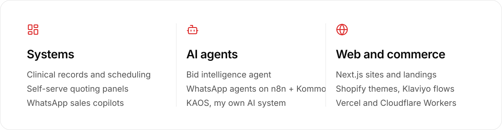
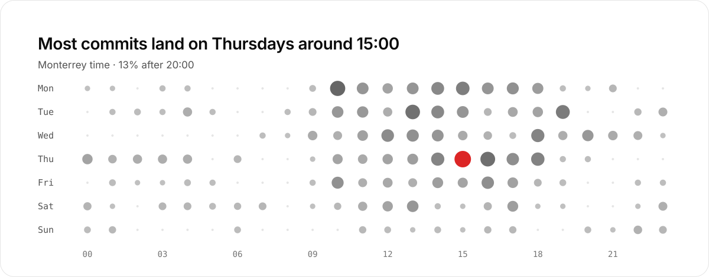
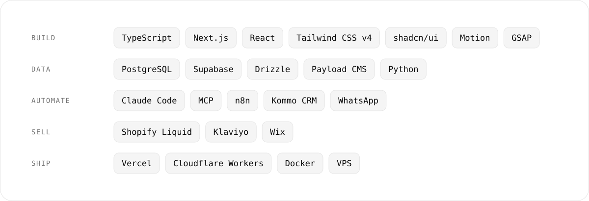

<picture>
  <source media="(prefers-color-scheme: dark)" srcset="./assets/hero-dark.svg">
  
</picture>

I build the software side of a consulting agency focused on ads and growth: management systems, AI agents, Shopify stores and the landing pages that sell all of it. Almost everything I ship runs in production for businesses in Mexico and the US.

<a href="https://dev.maugn.com">
  <picture>
    <source media="(prefers-color-scheme: dark)" srcset="./assets/cta-dark.svg">
    
  </picture>
</a>

## What I build

<picture>
  <source media="(prefers-color-scheme: dark)" srcset="./assets/areas-dark.svg">
  
</picture>

## When I ship

<picture>
  <source media="(prefers-color-scheme: dark)" srcset="./assets/rhythm-dark.svg">
  
</picture>

## Building now

<picture>
  <source media="(prefers-color-scheme: dark)" srcset="./assets/now-dark.svg">
  
</picture>

## Stack

<picture>
  <source media="(prefers-color-scheme: dark)" srcset="./assets/stack-dark.svg">
  
</picture>

Off the keyboard: sound engineering, design and video.

**[Portfolio](https://dev.maugn.com)** · [LinkedIn](https://www.linkedin.com/in/mauricio-guerra-955628273/)

Stats count my own commits on default branches across personal and agency repositories, Monterrey time. They refresh on the 1st of every month.
