<picture>
  <source media="(prefers-color-scheme: dark)" srcset="./assets/year-dark.svg">
  
</picture>

I build the software side of a consulting agency focused on ads and growth: management systems, AI agents, Shopify stores and the landing pages that sell all of it. Almost everything I ship runs in production for businesses in Mexico and the US.

## The last 12 months

**Systems**

- A clinical management platform: public site, patient portal, operations dashboard and an agent layer, all on one electronic health record.
- A self-service quoting panel that lets a non-technical sales team manage its own PDF quotes, connected to n8n flows.
- A sales copilot that quotes over WhatsApp and reports to its own panel.

**AI agents**

- A bid intelligence agent that finds public tenders, scores them with AI, emails the buyers with one follow-up and qualifies their replies on a live dashboard.
- A WhatsApp agent on n8n and Kommo for a hospitality venue, shipped with sanitized workflows and documentation.

**Web**

- An architecture firm portfolio on Next.js 15 and Payload CMS.
- A luxury B2C site running on Cloudflare Workers.
- Landing pages for restaurants, food brands, solar installers, logistics, insurance and health clinics.

## Building now

**KAOS**, my personal AI system. One assistant with a single memory, a model of the world and of itself, a chat in its own panel and on WhatsApp, and hands that run jobs on a self-hosted server. 413 commits this year, more than any other project.

## Live

| Project | What it is |
| --- | --- |
| [Nexo](https://w-y-system.vercel.app) | Cloud CRM and ERP layer on top of Aspel SAE: pipeline, mobile quoting over WhatsApp, collections and live dashboards |
| [SOLPOWER](https://solpower.vercel.app) | Solar panel landing page for Monterrey |
| [La Nación](https://la-nacion-pawnshop.vercel.app) | Pawnshop site with loans and a product catalog |
| [Victory Tracks](https://landing-victorytracks.vercel.app) | Landing page for an athletic track repair company in the US |

## Stack

| Layer | Tools |
| --- | --- |
| Build | TypeScript · Next.js · React · Tailwind CSS v4 · shadcn/ui · Motion · GSAP |
| Data | PostgreSQL · Supabase · Drizzle · Payload CMS · Python |
| Automate | Claude Code · MCP · n8n · Kommo CRM · WhatsApp |
| Sell | Shopify (Liquid) · Klaviyo · Wix |
| Ship | Vercel · Cloudflare Workers · Docker · self-hosted VPS |

Off the keyboard: sound engineering, design and video.

[Portfolio](https://dev.maugn.com) · [LinkedIn](https://www.linkedin.com/in/mauricio-guerra-955628273/)

Stats count my own commits on default branches across personal and agency repositories, Nov 24, 2025 to Nov 23, 2026, pulled from the GitHub API.
